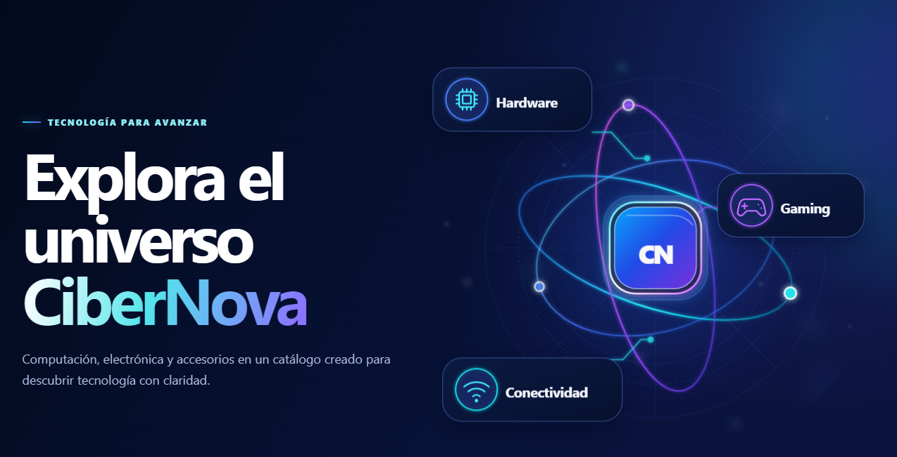

<div align="center">

# 💻 CiberNova

### E-Commerce de Tecnología, Computación y Electrónica

**Una experiencia de compra moderna, responsive y orientada a búsqueda, construida con React, TypeScript, Node.js y Algolia.**

<br>


<br>

[Ver sitio desplegado](https://rajami1205.github.io/Proyecto_Comercio_Electronico/) ·
[API de producción](https://cibernova-api.onrender.com) ·
[Repositorio](https://github.com/RaJami1205/Proyecto_Comercio_Electronico)

</div>

---

<div align="center">



</div>

---

# 🚀 CiberNova

**CiberNova** es una aplicación web de comercio electrónico enfocada en la venta de productos de tecnología, computación y electrónica.

El proyecto fue desarrollado como parte del curso de **Comercio Electrónico** del Tecnológico de Costa Rica y busca ofrecer una experiencia de compra moderna, intuitiva y adaptable a distintos dispositivos.

La plataforma integra un catálogo conectado con **Algolia**, búsqueda predictiva, filtros, paginación, Product Quick View y un carrito de compras persistente. El **Proyecto II** amplió esta base con un Checkout de cuatro etapas, creación de Orders autoritativas, Payment Sandbox, resultados de pago, Purchase Confirmation y Safe Cart Cleanup.

La arquitectura separa claramente el frontend y backend: el Server protege las credenciales de Algolia, valida disponibilidad y calcula los importes definitivos. El Payment Sandbox simula los pagos sin realizar transacciones bancarias reales.

---

# 📑 Contenido

- [Características principales](#-características-principales)
- [Experiencia de compra](#-experiencia-de-compra)
- [Tecnologías](#-tecnologías)
- [Arquitectura](#-arquitectura)
- [Arquitectura del carrito](#-arquitectura-del-carrito)
- [Búsqueda y catálogo](#-búsqueda-y-catálogo)
- [Diseño responsive](#-diseño-responsive)
- [Estructura del proyecto](#-estructura-del-proyecto)
- [Requisitos](#-requisitos)
- [Clonar el proyecto](#-clonar-el-proyecto)
- [Instalación](#-instalación)
- [Variables de entorno](#-variables-de-entorno)
- [Ejecutar localmente](#-ejecutar-localmente)
- [Comandos principales](#-comandos-principales)
- [Algolia y dataset](#-algolia-y-dataset)
- [Validaciones](#-validaciones)
- [Git y flujo de desarrollo](#-git-y-flujo-de-desarrollo)
- [Despliegue](#-despliegue)
- [Seguridad](#-seguridad)
- [Estado actual](#-estado-actual)
- [Autores](#-autores)
- [Licencia](#-licencia)

---

# ✨ Características principales

CiberNova incorpora las principales funcionalidades de un E-Commerce B2C, desarrolladas de manera incremental entre el catálogo, el carrito y el Checkout.

### Catálogo

- Catálogo dinámico conectado con Algolia.
- Productos de computación, hardware, gaming, conectividad y electrónica.
- Imágenes, precio, disponibilidad y datos principales por producto.
- Diseño mediante cards reutilizables.
- Paginación adaptada a desktop, tablet y mobile.

### Búsqueda

- Búsqueda dinámica.
- Autocomplete.
- Predictive Search.
- Recent Searches en memoria.
- Resultados sincronizados con el catálogo.
- Limpieza rápida de búsqueda.
- Navegación hacia productos desde sugerencias.

### Filtros

- Categorías.
- Marcas.
- Rangos de precio.
- Navegación jerárquica de categorías.
- Actualización dinámica de resultados.

### Product Quick View

- Vista detallada sin abandonar el catálogo.
- Imagen principal.
- Precio.
- Stock.
- Descripción.
- Especificaciones.
- Acción directa para agregar al carrito.

### Shopping Cart

- Estado global compartido mediante React Context API.
- Gestión de cantidades mediante `useReducer`.
- Agregar productos desde catálogo o Quick View.
- Incrementar, disminuir y eliminar unidades.
- Contador de productos, Empty State y Cart Preview.
- Persistencia local y sincronización mediante eventos `storage`.
- Resumen financiero y diseño responsive.
- Seguimiento de incorporaciones para preservar productos ajenos durante Safe Cart Cleanup.

### Checkout

- Flujo de cuatro etapas: Comprador, Entrega, Revisión y Pago.
- Formularios de Buyer y Delivery con validación.
- Revisión de productos, cantidades y totales antes de crear la Order.
- Detección y aceptación explícita de diferencias entre importes preliminares y autoritativos.
- Recuperación de solicitudes de creación inciertas mediante Idempotency.

### Orders y Payment Sandbox

- Creación y consulta de Orders mediante REST API.
- Validación de productos, disponibilidad y cantidades en Server.
- Precios y totales definitivos calculados por Server a partir del catálogo.
- Payment Sandbox con escenarios APPROVED, DECLINED y ERROR.
- Campos de tarjeta exclusivamente demostrativos, sin envío ni almacenamiento de sus valores.
- Protección contra Double Submit, intentos duplicados y reintentos inconsistentes.
- Resultados de pago con feedback y Retry sobre la misma Order cuando corresponde.

### Purchase Confirmation

- Confirmación de compra únicamente con Order `CONFIRMED / APPROVED`.
- Visualización del número de Order, comprador, entrega, productos y totales autoritativos.
- Safe Cart Cleanup limitado a las unidades adquiridas, conservando incorporaciones posteriores.
- Conservación del carrito ante pagos rechazados, errores y resultados inciertos.
- Regreso al catálogo sin crear otra Order ni reprocesar el pago.

---

# 🛒 Experiencia de compra

El flujo principal de usuario es:

```text
Explorar catálogo
      ↓
Buscar / filtrar productos
      ↓
Consultar Product Quick View
      ↓
Agregar productos al carrito
      ↓
Modificar cantidades y revisar el resumen
      ↓
Checkout: Comprador → Entrega → Revisión
      ↓
Crear Order (POST /api/orders)
      ↓
Payment Sandbox
      ↓
┌───────────────┬───────────────┬───────────────┐
│ APPROVED      │ DECLINED      │ ERROR         │
│ Confirmación  │ Retry         │ Retry         │
│ Safe Cleanup  │ Misma Order   │ Misma Order   │
└───────────────┴───────────────┴───────────────┘
      ↓
Volver al catálogo tras la confirmación
```

El carrito muestra cálculos preliminares; el Server calcula los importes definitivos de cada Order utilizando los precios vigentes del catálogo.

La política financiera aprobada es:

```text
Subtotal por producto = Precio unitario × Cantidad
Subtotal general = Σ subtotales sin redondeo previo
IVA (13 %) = Math.round(Subtotal × 100 × 0.13) / 100

Subtotal para elegibilidad de envío = Math.round(Subtotal)
Envío:
  Subtotal <= 0                              → ₡0
  Subtotal > 0 y elegibilidad < ₡100 000     → ₡3 500
  Elegibilidad >= ₡100 000                   → ₡0

Total = Subtotal original + IVA + Envío
```

El redondeo del subtotal completo se utiliza **únicamente para evaluar el envío gratuito**, antes del IVA. No se redondean los precios ni los subtotales de cada producto para acumular la compra. Por ejemplo, un subtotal de ₡99 999,50 obtiene envío gratuito, mientras que ₡99 999,49 mantiene el costo de envío.

En **Review**, si el Server devuelve precios o importes diferentes, el usuario debe aceptar los valores autoritativos antes de continuar. Una Order se crea con estado `PENDING / PENDING`; el Payment Sandbox permite estos resultados:

| Escenario | Order Status | Payment Status | Acción disponible |
|---|---|---|---|
| `PAYMENT_APPROVED` | `CONFIRMED` | `APPROVED` | Purchase Confirmation y Safe Cart Cleanup |
| `PAYMENT_DECLINED` | `PENDING` | `DECLINED` | Retry sobre la misma Order |
| `PAYMENT_ERROR` | `PENDING` | `ERROR` | Retry sobre la misma Order |

Los errores técnicos de comunicación se distinguen de los escenarios simulados. Los intentos inciertos conservan su identidad (`orderId`, `scenario` e `idempotencyKey`) mientras el Checkout permanezca activo. No se procesan pagos reales.

---

# 🧰 Tecnologías

## Frontend


- React
- TypeScript
- Vite
- CSS Modules
- Fetch API
- Context API
- `useReducer`
- Local Storage
- `Intl.NumberFormat`

## Backend


- Node.js
- TypeScript
- Express
- Algolia JavaScript API Client
- CORS
- dotenv

## Desarrollo y DevOps


- Git
- GitHub
- npm
- ESLint
- GitHub Actions
- GitHub Pages
- Render
- Visual Studio Code

---

# 🏗️ Arquitectura

CiberNova utiliza una arquitectura separada entre cliente y servidor.

```text
┌──────────────────────┐
│      Navegador       │
│                      │
│ React + TypeScript   │
└──────────┬───────────┘
           │
           │ HTTPS / Fetch API
           ↓
┌──────────────────────┐
│     Express API      │
│                      │
│ Node.js + TypeScript │
└──────────┬───────────┘
           │
           │ Algolia Client
           ↓
┌──────────────────────┐
│       Algolia        │
│                      │
│ Search / Faceting    │
└──────────────────────┘
```

El flujo de datos principal es:

```text
React
  ↓
Hooks / Services
  ↓
Fetch API
  ↓
Express Route
  ↓
Controller
  ↓
Service
  ↓
Algolia
  ↓
Mapper
  ↓
JSON Response
  ↓
React
```

Este diagrama representa la consulta de catálogo. Para el flujo de compra, Express incorpora servicios de Order y Payment con almacenamiento temporal en memoria:

```text
React Checkout
      ↓
POST /api/orders
      ↓
OrderService ← Algolia (precios y stock)
      ↓
InMemoryOrderStore
      ↓
Order autoritativa
      ↓
POST /api/orders/:orderId/payment
      ↓
PaymentService → Payment Sandbox
      ↓
PaymentResult → Purchase Confirmation / Retry
```

También está disponible `GET /api/orders/:orderId` para consultar una Order existente. Orders, Idempotency y locks del Sandbox residen en memoria del proceso Server; no existe una base de datos transaccional persistente.

Esta separación evita que el frontend tenga acceso directo a credenciales privadas de Algolia o a controles autoritativos de la transacción.

## Responsabilidades del Client

El directorio `client/` contiene:

- presentación;
- componentes;
- navegación de interfaz;
- estado del catálogo;
- búsqueda;
- filtros;
- paginación;
- estado global y persistencia del carrito;
- cálculos derivados y vistas preliminares;
- formularios de Buyer y Delivery;
- Checkout, Review y comunicación con las APIs de Order y Payment;
- estados visuales Approved, Declined y Error;
- Purchase Confirmation y coordinación de Safe Cart Cleanup;
- responsive design y Focus Management.

## Responsabilidades del Server

El directorio `server/` contiene:

- API Express;
- configuración;
- validación de variables de entorno;
- comunicación con Algolia;
- controllers;
- services;
- mappers;
- procesamiento de categorías;
- validación de stock y cálculo de importes autoritativos;
- creación, consulta e Idempotency de Orders;
- Payment Sandbox, estados y guards de concurrencia;
- InMemoryOrderStore y manejo de errores;
- herramientas administrativas como el seed de Algolia.

---

# 🛍️ Arquitectura del carrito

El Shopping Cart mantiene una única fuente de verdad para sus productos.

```text
React Components
       ↓
    useCart()
       ↓
  CartContext
       ↓
  CartProvider
       ↓
   useReducer
       ↓
   CartState
```

El estado global mantiene principalmente:

```text
CartState
└── items: CartItem[]
```

Cada `CartItem` conserva un snapshot mínimo del producto y metadatos necesarios para el cierre selectivo de una compra:

```text
CartItem
├── productId
├── name
├── price
├── image
├── quantity
└── metadatos de incorporación y unidades retiradas
```

Los valores financieros no se almacenan como una segunda fuente de verdad. Se calculan como `derived state` mediante funciones puras:

```text
CartState.items
      ↓
cartCalculations
      ↓
subtotal
IVA
shipping
total
```

El cálculo mostrado en Cart es preliminar; en Checkout, los importes definitivos proceden del Server.

### Safe Cart Cleanup

Después de una confirmación autoritativa `CONFIRMED / APPROVED`, Checkout solicita una transición `CLEANUP_PURCHASE` al reducer para retirar **solo las unidades originales asociadas con esa compra**. No utiliza un `clearCart()` indiscriminado: preserva unidades añadidas posteriormente, productos nuevos y líneas eliminadas y reincorporadas. Re-renders y Confirmed Order Replay no deben provocar un segundo descuento.

## Persistencia del carrito

El carrito utiliza almacenamiento local para conservar los productos entre recargas del navegador. La persistencia se mantiene separada de la lógica pura del reducer.

```text
CartState
   ↕
cartStorage
   ↕
localStorage
```

La sincronización disponible mediante eventos `storage` permite reflejar cambios de otras pestañas, pero **no garantiza transacciones atómicas entre pestañas**. Ante metadatos antiguos o ambiguos, la limpieza adopta una estrategia conservadora para evitar eliminar productos incorrectos.

La persistencia es exclusiva del carrito. Los datos personales de Buyer/Delivery, los intentos de Payment, **Predictive Search** y **Recent Searches** no se almacenan mediante esta persistencia y permanecen temporales según su correspondiente flujo.

---

# 🔍 Búsqueda y catálogo

El catálogo utiliza Algolia como motor de búsqueda.

La aplicación permite:

```text
Query
 ↓
Autocomplete
 ↓
Predictive Search
 ↓
Filtros
 ↓
Paginación
 ↓
Resultados
```

Las consultas se realizan mediante el backend:

```text
Client
  ↓
/api/products
  ↓
Express
  ↓
Algolia
```

## Recent Searches

Las búsquedas recientes son deliberadamente **memory-only**.

No utilizan:

- `localStorage`
- `sessionStorage`
- IndexedDB
- cookies
- backend persistence

Al recargar o cerrar la aplicación, el historial se reinicia.

---

# 📱 Diseño responsive

CiberNova fue diseñada para adaptarse a:

- Desktop
- Tablet
- Mobile

El catálogo utiliza distintas densidades dependiendo del viewport.

| Vista | Columnas | Productos por página |
|---|---:|---:|
| Desktop | 3 | 9 |
| Tablet | 3 | 6 |
| Mobile | 2 | 6 |

El carrito, el Checkout multi-step, el Payment Sandbox y Purchase Confirmation también adaptan su composición y sus controles al viewport.

### Desktop / Tablet

```text
┌───────────────────────────────┬────────────────────┐
│ Productos                     │ Resumen de compra  │
│                               │                    │
│ Item                          │ Subtotal           │
│ Item                          │ IVA                │
│ Item                          │ Envío              │
│                               │ Total              │
└───────────────────────────────┴────────────────────┘
```

### Mobile

```text
┌─────────────────────┐
│ Producto            │
├─────────────────────┤
│ Producto            │
├─────────────────────┤
│ Resumen de compra   │
└─────────────────────┘
```

Los formularios de Checkout, las tarjetas de escenario y la confirmación se reorganizan en mobile; se priorizan campos legibles, focus visible, identificadores con wrapping y acciones accesibles.

La interfaz utiliza una identidad visual basada en:

- navy oscuro;
- electric blue;
- cyan;
- violeta;
- fondos claros;
- bordes suaves;
- efectos de profundidad y glow controlado.

---

# 📂 Estructura del proyecto

```text
E_Commerce/
│
├── .github/
│   └── workflows/
│       └── deployment.yml
│
├── client/
│   ├── src/
│   │   ├── assets/
│   │   ├── components/
│   │   │   ├── cart/
│   │   │   ├── catalog/
│   │   │   ├── checkout/
│   │   │   └── layout/
│   │   ├── context/
│   │   ├── hooks/
│   │   ├── pages/
│   │   ├── services/
│   │   ├── styles/
│   │   ├── types/
│   │   ├── utils/
│   │   ├── App.tsx
│   │   └── main.tsx
│   │
│   ├── tests/
│   ├── package.json
│   └── vite.config.ts
│
├── server/
│   ├── data/
│   │   └── productos.json
│   │
│   ├── src/
│   │   ├── config/
│   │   ├── controllers/
│   │   ├── domain/
│   │   ├── mappers/
│   │   ├── routes/
│   │   ├── scripts/
│   │   ├── services/
│   │   ├── types/
│   │   ├── app.ts
│   │   └── index.ts
│   │
│   ├── tests/
│   └── package.json
│
├── docs/
│   └── assets/
│       └── cibernova-panel.png
│
├── AGENTS.md
└── README.md
```

`client/` y `server/` son aplicaciones independientes y administran sus dependencias mediante sus respectivos archivos `package.json`. Los contratos de Order y Payment se mantienen en ambos proyectos con compatibilidad Client/Server, sin imports directos entre sus fuentes.

---

# ✅ Requisitos

Antes de ejecutar el proyecto se requiere:

- Git
- Node.js
- npm
- navegador web moderno
- acceso a Algolia para ejecutar el backend completo

Verificar las herramientas:

```bash
git --version
node --version
npm --version
```

---

# 📥 Clonar el proyecto

Repositorio:

```text
https://github.com/RaJami1205/Proyecto_Comercio_Electronico
```

Clonar:

```bash
git clone https://github.com/RaJami1205/Proyecto_Comercio_Electronico.git
```

Ingresar al proyecto:

```bash
cd Proyecto_Comercio_Electronico
```

---

# ⚙️ Instalación

El `client` y el `server` mantienen dependencias independientes.

## Client

```bash
cd client
npm install
```

## Server

Desde la raíz:

```bash
cd server
npm install
```

Para una instalación reproducible utilizando el lockfile también puede utilizarse:

```bash
npm ci
```

---

# 🔐 Variables de entorno

Los archivos `.env` no deben almacenarse en Git.

## Client

Crear:

```text
client/.env
```

Ejemplo para desarrollo local:

```env
VITE_API_BASE_URL=http://localhost:3000
```

En producción, esta variable apunta hacia la API desplegada en Render.

## Server

Crear:

```text
server/.env
```

El backend requiere las variables de configuración correspondientes a:

- aplicación de Algolia;
- índice de productos;
- credencial autorizada del servidor;
- puerto de ejecución;
- configuración permitida por el entorno.

Los nombres y validaciones deben mantenerse consistentes con la configuración definida en:

```text
server/src/config/env.ts
```

Las credenciales privadas nunca deben utilizarse directamente desde `client/`.

---

# ▶️ Ejecutar localmente

Frontend y backend deben ejecutarse en terminales independientes.

## 1. Server

```bash
cd server
npm run dev
```

El backend utilizará el puerto configurado para el entorno local.

## 2. Client

En otra terminal:

```bash
cd client
npm run dev
```

Vite mostrará la URL local, normalmente:

```text
http://localhost:5173
```

El flujo será:

```text
Browser
   ↓
React / Vite (Catalog, Cart, Checkout)
   ↓
Express API
   ├── Algolia (Catálogo, stock y precios)
   └── Orders y Payment Sandbox (memoria del proceso)
```

---

# ⌨️ Comandos principales

## Client

| Comando | Descripción |
|---|---|
| `npm run dev` | Ejecuta Vite en modo desarrollo |
| `npm run lint` | Ejecuta ESLint |
| `npm run build` | Genera el build de producción |
| `npm run preview` | Previsualiza localmente el build |

## Server

| Comando | Descripción |
|---|---|
| `npm run dev` | Ejecuta el backend en desarrollo |
| `npm run build` | Compila TypeScript |
| `npm start` | Inicia el backend compilado |
| `npm run seed:algolia` | Ejecuta la herramienta controlada de seed de Algolia |

---

# 🧠 Algolia y dataset

El catálogo de CiberNova utiliza Algolia como motor de búsqueda y faceting.

El dataset mantenido por el proyecto se encuentra en:

```text
server/data/productos.json
```

El repositorio incluye una herramienta de seed para reproducir la carga de productos hacia Algolia:

```text
server/src/scripts/seedAlgolia.ts
```

La herramienta fue diseñada con protecciones para evitar escrituras accidentales.

El comportamiento predeterminado es de validación / `dry-run`.

La escritura sobre Algolia requiere una acción explícita y credenciales separadas destinadas al seed.

El seed:

- no se ejecuta al iniciar el servidor;
- no forma parte del deployment normal;
- no se ejecuta automáticamente desde Render;
- no modifica settings o replicas del índice de forma implícita.

Debe utilizarse únicamente cuando sea necesario reconstruir o actualizar deliberadamente los productos del índice.

---

# 🧪 Validaciones

Antes de integrar cambios se deben ejecutar las validaciones correspondientes.

## Client

```bash
cd client
npm run lint
npm run build
```

Para ejecutar la suite de regresión del carrito, Checkout, Orders y Payment desde `client/`:

```bash
node --test tests/cartCalculations.test.mjs tests/cartCleanup.test.mjs tests/orderApi.test.mjs tests/checkoutCorrections.test.mjs tests/paymentIntegrity.test.mjs tests/safeCartCleanup.test.mjs tests/confirmation.test.mjs
```

## Server

```bash
cd server
npm run build
```

Para verificar las reglas de Order y stock con pruebas aisladas desde `server/`:

```bash
node --test tests/orderCorrections.test.mjs
```

En la última auditoría integral de CN-33 se reportaron **96 pruebas Client y 40 pruebas Server aprobadas**, además de `lint` y ambos builds satisfactorios. Las pruebas mencionadas usan aislamiento y mocks; no sustituyen la revisión manual en navegador ni las pruebas contra servicios externos.

Todos los comandos deben finalizar correctamente antes de integrar cambios hacia las ramas principales.

---

# 🌿 Git y flujo de desarrollo

El proyecto utiliza una estrategia basada en:

```text
main
└── dev
    └── feature/*
```

Flujo habitual:

```text
feature/*
   ↓
Pull Request
   ↓
dev
   ↓
validación
   ↓
Pull Request
   ↓
main
```

### `main`

Representa la versión estable y desplegable.

### `dev`

Representa la rama de integración.

### `feature/*`

Cada funcionalidad o corrección se desarrolla de forma aislada antes de integrarse.

Las integraciones se realizan mediante Pull Requests.

---

# 🌐 Despliegue

La solución utiliza deployments independientes para frontend y backend.

## Frontend — GitHub Pages

El frontend está desplegado mediante:

```text
GitHub Actions
       ↓
npm ci
       ↓
npm run lint
       ↓
npm run build
       ↓
GitHub Pages
```

El workflow se encuentra en:

```text
.github/workflows/deployment.yml
```

Se ejecuta automáticamente cuando existen nuevos cambios en:

```text
main
```

Sitio:

**https://rajami1205.github.io/Proyecto_Comercio_Electronico/**

Cada nuevo deployment actualiza el sitio existente y conserva la misma URL. El workflow publicado sigue la rama `main`; las features integradas únicamente en `dev` no se consideran desplegadas automáticamente.

## Backend — Render

La API Express está desplegada mediante un Web Service de Render.

API:

**https://cibernova-api.onrender.com**

Render está conectado al repositorio y a la rama:

```text
main
```

con:

```text
Auto-Deploy: On Commit
```

Por tanto, los nuevos commits integrados en `main` actualizan automáticamente el backend.

La URL del servicio permanece estable entre deployments. Las implementaciones de Checkout, Orders y Payment Sandbox deben llegar a `main` y superar el deployment correspondiente antes de darse por disponibles en producción.

> El plan gratuito de Render puede suspender temporalmente la instancia después de un periodo de inactividad, por lo que la primera solicitud puede presentar un tiempo de respuesta mayor.

## Algolia

Algolia funciona como servicio externo para:

- catálogo;
- búsqueda;
- autocomplete;
- filtros;
- faceting;
- paginación.

El deployment del frontend o backend no ejecuta automáticamente el seed.

---

# 🛡️ Seguridad

El proyecto sigue las siguientes prácticas:

- archivos `.env` excluidos del repositorio;
- credenciales privadas únicamente en backend;
- ninguna API Key administrativa expuesta al navegador;
- comunicación con Algolia centralizada mediante Express;
- validación de variables de entorno;
- CORS configurado para los orígenes permitidos;
- seed de Algolia protegido contra escrituras accidentales;
- variables de producción administradas desde GitHub y Render;
- validación mediante lint, build y suites de regresión antes de integrar cambios;
- cálculo y validación autoritativa de Orders en Server;
- Idempotency y controles de concurrencia en Order y Payment;
- Payment Sandbox sin cargos reales: los campos demostrativos de tarjeta no se envían al Server ni se guardan;
- datos de Buyer/Delivery y estado transaccional temporal sin persistencia añadida en el navegador;
- Safe Cart Cleanup condicionado a la confirmación autoritativa de compra.

---

# 📊 Estado actual

<div align="center">


</div>

El desarrollo del **Laboratorio 3** y la ampliación funcional del **Proyecto II** se encuentran completados y validados en el entorno de desarrollo e integración. La aplicación incorpora:

- catálogo dinámico, Algolia, búsqueda predictiva, filtros y paginación;
- Product Quick View y carrito global persistente;
- Cart Preview, cálculo de subtotal, IVA del 13 %, Shipping y Total;
- Checkout multi-step: Comprador, Entrega, Revisión y Pago;
- creación y consulta de Orders con precios y disponibilidad autoritativos;
- comparación y aceptación de diferencias financieras en Review;
- Order y Payment Idempotency, Replay y Retry controlado;
- Payment Sandbox con Approved, Declined y Error, sin procesamiento bancario real;
- tarjetas de demostración locales, sin transmisión de datos bancarios;
- Purchase Confirmation con información definitiva de la Order;
- Safe Cart Cleanup que preserva productos y cantidades incorporados posteriormente;
- pruebas de regresión, diseño responsive y Focus Management;
- integración Client–Server y configuración de deployment automatizado.

La arquitectura se desarrolló de forma incremental y conserva la separación entre presentación, estado, lógica de negocio, servicios y acceso a datos.

**Estado de publicación:** el desarrollo del Proyecto II se ha validado e integrado en `dev`; los cambios de la rama de corrección actual se encuentran pendientes de su integración. Los enlaces de producción corresponden a los deployments de `main`, por lo que la disponibilidad pública de todas las funciones del Proyecto II depende de su posterior promoción y despliegue.

---

# 👥 Autores

Proyecto académico desarrollado para el curso de **Comercio Electrónico**.

**Tecnológico de Costa Rica**

**Escuela de Ingeniería en Computación**

---

# 📄 Licencia

Este proyecto fue desarrollado con fines académicos y educativos.

Su contenido se utiliza como parte del proceso de aprendizaje y evaluación del curso de Comercio Electrónico.

---

<div align="center">

### CiberNova

**Tecnología, computación y electrónica en una experiencia de compra moderna.**

React · TypeScript · Vite · Node.js · Express · Algolia

</div>
