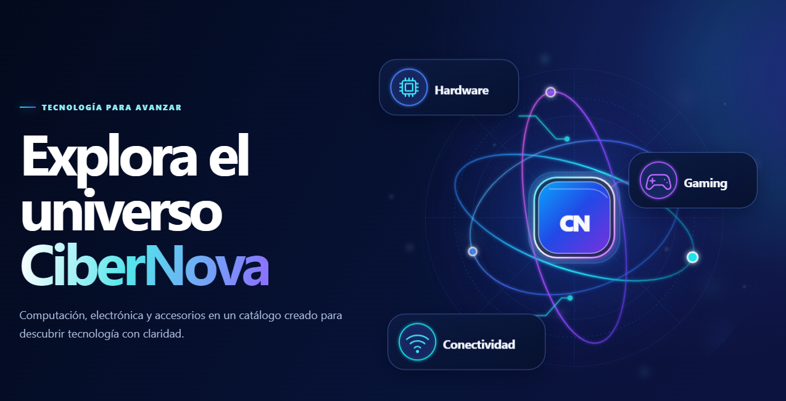

<div align="center">

# 💻 CiberNova

### E-Commerce de Tecnología, Computación y Electrónica

**Una experiencia de compra moderna, responsive y multirrol, desarrollada con React, TypeScript, Node.js, Algolia y PostgreSQL.**

<br>


<br>

[Ver sitio desplegado](https://rajami1205.github.io/Proyecto_Comercio_Electronico/) ·
[API de producción](https://cibernova-api.onrender.com) ·
[Repositorio](https://github.com/RaJami1205/Proyecto_Comercio_Electronico)

</div>

---

<div align="center">



</div>

---

# 🚀 CiberNova

**CiberNova** es una aplicación web de comercio electrónico enfocada en la venta de productos de tecnología, computación y electrónica. Su evolución incorpora experiencias de compra **B2C y B2B**, así como herramientas de consulta para **ADMIN**.

El proyecto fue desarrollado como parte del curso de **Comercio Electrónico** del Tecnológico de Costa Rica y busca ofrecer una experiencia de compra moderna, intuitiva y adaptable a distintos dispositivos.

La plataforma integra un catálogo conectado con **Algolia**, búsqueda predictiva, filtros, paginación, Product Quick View y un carrito de compras persistente. El flujo comercial incorpora **Retail/Wholesale Pricing**, MOQ para B2B, disponibilidad en cuatro sucursales, Checkout de cuatro etapas, Orders autoritativas, Payment Sandbox, Purchase Confirmation y Safe Cart Cleanup.

Integra Simulated Login con identidades **B2C, B2B y ADMIN**, Order History por comprador y un panel administrativo para consultar Orders, Products e Inventory. **B2C y B2B** pueden realizar compras según sus condiciones comerciales; **ADMIN** tiene acceso de consulta y simulación, pero no puede comprar. El Dashboard de Analytics local está reservado a ADMIN.

Además cuenta con políticas comerciales, FAQ y aceptación obligatoria de Términos y Condiciones durante Checkout.

La arquitectura separa claramente el frontend y backend: el Server protege las credenciales de Algolia, verifica identidad y permisos, valida disponibilidad y calcula los importes definitivos. **PostgreSQL** almacena Orders y Payment Attempts cuando se habilita explícitamente el modo persistente; Algolia proporciona búsqueda y una proyección derivada de Orders. El **Payment Sandbox** simula los pagos sin realizar transacciones bancarias reales.

---

# 📑 Contenido

- [Características principales](#-características-principales)
- [Experiencia de compra](#-experiencia-de-compra)
- [Confianza digital y políticas comerciales](#-confianza-digital-y-políticas-comerciales)
- [Tecnologías](#-tecnologías)
- [Arquitectura](#-arquitectura)
- [Arquitectura del carrito](#-arquitectura-del-carrito)
- [Búsqueda y catálogo](#-búsqueda-y-catálogo)
- [Analytics y personalización](#-analytics-y-personalización)
- [Diseño responsive](#-diseño-responsive)
- [Estructura del proyecto](#-estructura-del-proyecto)
- [Requisitos](#-requisitos)
- [Clonar el proyecto](#-clonar-el-proyecto)
- [Instalación](#-instalación)
- [Variables de entorno](#-variables-de-entorno)
- [Ejecutar localmente](#-ejecutar-localmente)
- [Comandos principales](#-comandos-principales)
- [Algolia y dataset](#-algolia-y-dataset)
- [Validaciones](#-validaciones)
- [Git y flujo de desarrollo](#-git-y-flujo-de-desarrollo)
- [Despliegue](#-despliegue)
- [Seguridad](#-seguridad)
- [Estado actual](#-estado-actual)
- [Autores](#-autores)
- [Licencia](#-licencia)

---

# ✨ Características principales

CiberNova combina un E-Commerce **B2C/B2B** con un entorno administrativo **ADMIN**. Sus funcionalidades se desarrollaron de forma incremental, conservando las capacidades de catálogo, búsqueda, carrito y Checkout de las primeras etapas.

### Catálogo

- Catálogo dinámico conectado con Algolia.
- Productos de computación, hardware, gaming, conectividad y electrónica.
- Imágenes, precios contextuales, disponibilidad por sucursal y datos principales por producto.
- Diseño mediante cards reutilizables.
- Paginación adaptada a desktop, tablet y mobile.
- Precios Retail/Wholesale según la identidad comercial; validación definitiva en Server.

### Búsqueda

- Búsqueda dinámica.
- Autocomplete.
- Predictive Search.
- Recent Searches en memoria.
- Resultados sincronizados con el catálogo.
- Limpieza rápida de búsqueda.
- Navegación hacia productos desde sugerencias.

### Filtros

- Categorías.
- Marcas.
- Rangos de precio.
- Navegación jerárquica de categorías.
- Actualización dinámica de resultados.

### Product Quick View

- Vista detallada sin abandonar el catálogo.
- Imagen principal.
- Precio.
- Stock contextual para la sucursal seleccionada.
- Descripción.
- Especificaciones.
- Acción directa para agregar al carrito.

### Simulated Login

El selector obtiene las identidades mediante `GET /api/users`. Al elegir una, `POST /api/session/resolve` devuelve el usuario validado por el Server desde el índice de usuarios de Algolia. `SessionContext` conserva la identidad en memoria hasta Logout, cambio de usuario o reload. El Server valida roles, estado habilitado y datos obligatorios, y vuelve a resolver la identidad en operaciones protegidas. Se trata de **identidades simuladas**, no de autenticación real mediante contraseña.

### Roles y Pricing contextual

- **B2C:** catálogo con precios Retail, Cart, Checkout y consulta de su Order History.
- **B2B:** precios Wholesale, identificación de Company y **MOQ específico de cada producto** para compras comerciales.
- **ADMIN:** consulta de Orders, Products e Inventory, simulaciones administrativas y Analytics Dashboard; sin autorización para Checkout o Payment.
- Validaciones de rol, identidad, precios, MOQ y disponibilidad ejecutadas por el Server antes de crear una Order.

### Inventario multiesucursal

- Cuatro sucursales: **San José, Alajuela, Cartago y Heredia**.
- Selección de Branch para consultar stock y determinar la disponibilidad de compra.
- La Order conserva la sucursal elegida y el contexto comercial de la transacción.
- Rechazo de cantidades que exceden el inventario o incumplen el MOQ B2B.

### Analytics y experiencia personalizada

Seis eventos registran interacciones del catálogo y del flujo de compra. El catálogo ofrece Recent Searches y Recently Viewed Products por identidad. ADMIN puede abrir **Analytics** para consultar cuatro métricas agregadas del navegador.

### Shopping Cart

- Estado global compartido mediante React Context API.
- Gestión de cantidades mediante `useReducer`.
- Agregar productos desde catálogo o Quick View.
- Incrementar, disminuir y eliminar unidades.
- Contador de productos, Empty State y Cart Preview.
- Persistencia local aislada por identidad y sincronización mediante eventos `storage`.
- Resumen financiero y diseño responsive.
- Seguimiento de incorporaciones para preservar productos ajenos durante Safe Cart Cleanup.

### Checkout

- Flujo de cuatro etapas: Comprador, Entrega, Revisión y Pago.
- Formularios de Buyer y Delivery con validación.
- Revisión de productos, cantidades y totales antes de crear la Order.
- Detección y aceptación explícita de diferencias entre importes preliminares y autoritativos.
- Recuperación de solicitudes de creación inciertas mediante Idempotency.
- Checkout habilitado para identidades B2C y B2B válidas; se conserva la sucursal seleccionada y se aplica el MOQ cuando corresponde.

### Orders y Payment Sandbox

- Creación y consulta de Orders mediante REST API, con snapshots históricos de identidad, rol, Company (B2B), Branch y condiciones comerciales.
- Validación de productos, disponibilidad y cantidades en Server.
- Precios y totales definitivos calculados por Server a partir del catálogo.
- Payment Sandbox con escenarios APPROVED, DECLINED y ERROR.
- Campos de tarjeta exclusivamente demostrativos, sin envío ni almacenamiento de sus valores.
- Protección contra Double Submit, intentos duplicados y reintentos inconsistentes.
- Persistencia autoritativa de Orders y Payment Attempts en PostgreSQL cuando se selecciona ese Store; modo In-Memory disponible para ejecución alternativa.
- Idempotency, Retry, Replay histórico y recuperación tras reiniciar el Server en modo PostgreSQL.
- Resultados de pago con feedback y Retry sobre la misma Order cuando corresponde.

### Order History

- Historial y detalle de Orders asociados a la identidad del comprador.
- Lectura paginada con protección de **Ownership** y snapshots comerciales históricos.
- Recuperación de Orders históricas desde PostgreSQL cuando el Store persistente está activo.

### Panel administrativo

- **Admin Orders:** listado global de consulta, Search, Filters, Pagination y Order Detail con acceso restringido a ADMIN.
- **Admin Products:** consulta de catálogo y disponibilidad por sucursal.
- **Inventory Simulation:** simulación local de cambios de stock con confirmación y **Reset**, sin modificar el inventario autoritativo.
- **Analytics Dashboard:** métricas agregadas únicamente de la actividad local disponible en el navegador/origen.

### Purchase Confirmation

- Confirmación de compra únicamente con Order `CONFIRMED / APPROVED`.
- Visualización del número de Order, comprador, entrega, productos y totales autoritativos.
- Safe Cart Cleanup limitado a las unidades adquiridas, conservando incorporaciones posteriores.
- Conservación del carrito ante pagos rechazados, errores y resultados inciertos.
- Regreso al catálogo sin crear otra Order ni reprocesar el pago.

### Confianza Digital

- Cuatro páginas de políticas comerciales y FAQ con Accordion accesible.
- Navegación mediante Hash Routing y layout informativo reutilizable.
- TermsDialog para consultar los términos dentro de Checkout.
- Consentimiento explícito y versionado antes de crear una nueva Order.
- Validación autoritativa en Server y registro de aceptación en el snapshot de Order.

---

# 🛒 Experiencia de compra

El catálogo admite visitantes. Para continuar desde el Cart a Checkout, se selecciona una identidad **B2C o B2B válida** y una sucursal. B2C utiliza precios Retail; B2B utiliza Wholesale Pricing y respeta el MOQ específico de cada producto. ADMIN puede explorar el catálogo y consultar herramientas administrativas, pero no completar compras.

El flujo principal de usuario es:

```text
Explorar catálogo
      ↓
Buscar / filtrar productos
      ↓
Consultar Product Quick View
      ↓
Seleccionar identidad B2C / B2B y sucursal
      ↓
Agregar productos al carrito
      ↓
Modificar cantidades y revisar el resumen
      ↓
Checkout: Comprador → Entrega → Revisión
      ↓
Validar stock, Pricing y MOQ según la identidad
      ↓
Consulta de Términos y Condiciones
      ↓
Aceptación explícita y obligatoria
      ↓
Crear Order (POST /api/orders)
      ↓
Payment Sandbox
      ↓
┌───────────────┬───────────────┬───────────────┐
│ APPROVED      │ DECLINED      │ ERROR         │
│ Confirmación  │ Retry         │ Retry         │
│ Safe Cleanup  │ Misma Order   │ Misma Order   │
└───────────────┴───────────────┴───────────────┘
      ↓
Volver al catálogo tras la confirmación
```

Una nueva Order requiere aceptación válida. Client administra el Checkbox y permite consultar TermsDialog sin abandonar Checkout; abrir el diálogo no registra consentimiento ni es una condición técnica adicional. Server valida la declaración antes de construir el snapshot.

El carrito muestra cálculos preliminares; el Server calcula los importes definitivos de cada Order utilizando los precios vigentes del catálogo, el **Pricing** aplicable a B2C/B2B y la disponibilidad de la sucursal seleccionada.

La política financiera aprobada es:

```text
Subtotal por producto = Precio unitario × Cantidad
Subtotal general = Σ subtotales sin redondeo previo
IVA (13 %) = Math.round(Subtotal × 100 × 0.13) / 100
Subtotal para elegibilidad de envío = Math.round(Subtotal)
Envío:
  Subtotal <= 0                              → ₡0
  Subtotal > 0 y elegibilidad < ₡100 000     → ₡3 500
  Elegibilidad >= ₡100 000                   → ₡0
Total = Subtotal original + IVA + Envío
```

El redondeo del subtotal completo se utiliza **únicamente para evaluar el envío gratuito**, antes del IVA. No se redondean los precios ni los subtotales de cada producto para acumular la compra. Por ejemplo, un subtotal de ₡99 999,50 obtiene envío gratuito, mientras que ₡99 999,49 mantiene el costo de envío.

En **Review**, si el Server devuelve precios o importes diferentes, el usuario debe aceptar los valores autoritativos antes de continuar. Una Order se crea con estado `PENDING / PENDING`; su snapshot conserva el contexto de usuario, Company cuando aplica, Branch, Pricing, cantidades, totales y consentimiento. El Payment Sandbox permite estos resultados:

| Escenario | Order Status | Payment Status | Acción disponible |

|---|---|---|---|

| `PAYMENT_APPROVED` | `CONFIRMED` | `APPROVED` | Purchase Confirmation y Safe Cart Cleanup |

| `PAYMENT_DECLINED` | `PENDING` | `DECLINED` | Retry sobre la misma Order |

| `PAYMENT_ERROR` | `PENDING` | `ERROR` | Retry sobre la misma Order |

Los errores técnicos de comunicación se distinguen de los escenarios simulados. Los intentos inciertos conservan su identidad (`orderId`, `scenario` e `idempotencyKey`) mientras el Checkout permanezca activo. No se procesan pagos reales.

---

# 🔐 Confianza digital y políticas comerciales

## Políticas comerciales

CiberNova incorpora cuatro páginas informativas originales que describen las condiciones comerciales simuladas y el alcance académico de la plataforma:

| Página | Destino en la aplicación |

|---|---|

| Términos y Condiciones | `#terms` |

| Política de Devoluciones | `#returns-policy` |

| Política de Envíos | `#shipping-policy` |

| Política de Privacidad | `#privacy-policy` |

Reutilizan `PolicyLayout` y `PolicySection`, con navegación hash y la identidad responsive del sitio. Estas políticas no representan procesamiento de devoluciones ni entregas reales y no sustituyen los derechos aplicables de los consumidores.

## Preguntas Frecuentes

La página `#faq` organiza preguntas sobre compras, Payment Sandbox, costos y tiempos de envío, devoluciones, privacidad y atención al cliente. Utiliza un Accordion con elementos nativos `<details>` y `<summary>` para interacción por teclado y exposición del estado de expansión. Las respuestas remiten a las políticas correspondientes; el soporte se describe dentro del contexto académico, sin un canal operativo real.

## Aceptación obligatoria en Checkout

El Checkbox de Review inicia desmarcado y exige una aceptación explícita antes de crear una nueva Order. `TermsDialog` reutiliza el contenido versionado de CN-41 mediante `TermsContent` y permite consultarlo sin salir de Checkout; consultarlo no equivale a aceptarlo.

El consentimiento permanece en memoria del Client, sin persistencia en `localStorage`. Se captura en `CreationAttempt` como `termsAcceptance: { accepted, version }`, junto con la solicitud y su `idempotencyKey`. Ante un resultado ambiguo, Retry conserva ese payload y su versión original.

Una Order existente conserva su aceptación y no requiere generar una nueva. La aceptación posterior de diferencias financieras es una decisión independiente: permite continuar con los importes autoritativos de la misma Order, sin reemplazar el consentimiento de términos.

## Validación autoritativa en Server

El Server:

- exige `accepted === true`, sin coerción de tipos, y una versión reconocida;
- consulta Orders e intentos pendientes compatibles antes de exigir la versión vigente para una creación nueva;
- permite Replay compatible de versiones históricas que sigan reconocidas, pero no nuevas Orders con una versión retirada;
- incorpora `accepted` y `version` al Idempotency Fingerprint, excluyendo `acceptedAt`;
- registra `accepted`, `version` y `acceptedAt` en el snapshot, generando el timestamp ISO en Backend con el mismo instante de `createdAt`;
- ignora timestamps enviados por Client y conserva la metadata durante GET, Payment y Retry.

Una declaración inválida produce HTTP 400; reutilizar una key con otra identidad válida produce HTTP 409. `OrderApi` y `PaymentApi` exigen metadata válida en las Orders recibidas, incluido un timestamp ISO canónico, sin rechazar versiones históricas por ser distintas de la versión local vigente.

## Limitaciones del entorno académico

No existen pagos bancarios reales ni procesamiento automatizado real de devoluciones. CiberNova admite dos composiciones: **In-Memory**, cuyos datos transaccionales no sobreviven al reinicio del proceso, y **PostgreSQL**, que conserva Orders, Payment Attempts y snapshots, incluida la aceptación de términos. `acceptedAt` registra el instante del snapshot, pero no constituye una firma digital ni acredita una identidad real.

---

# 🧰 Tecnologías

## Frontend


- React
- TypeScript
- Vite
- CSS Modules
- Fetch API
- Context API
- `useReducer`
- Local Storage
- Web Locks API para coordinar las escrituras de Analytics entre pestañas
- `Intl.NumberFormat`

## Backend


- Node.js
- TypeScript
- Express
- Algolia JavaScript API Client
- PostgreSQL (driver `pg`) y Supabase como servicio de base de datos para la composición persistente.
- CORS
- dotenv

## Desarrollo y DevOps


- Git
- GitHub
- npm
- ESLint
- GitHub Actions
- GitHub Pages
- Render
- Visual Studio Code

---

# 🏗️ Arquitectura

CiberNova utiliza una arquitectura separada entre cliente y servidor. El Server valida las reglas comerciales y centraliza el acceso a los servicios externos. **Algolia** permite consultar Products/Users y buscar proyecciones de Orders; **PostgreSQL**, cuando está habilitado, es la fuente autoritativa de Orders y Payments.

```text
┌──────────────────────┐
│      Navegador       │
│                      │
│ React + TypeScript   │
└──────────┬───────────┘
           │
           │ HTTPS / Fetch API
           ↓
┌──────────────────────┐
│     Express API      │
│                      │
│ Node.js + TypeScript │
└──────────┬───────────┘
           │
           │ Algolia Client
           ↓
┌──────────────────────┐
│       Algolia        │
│                      │
│ Search / Faceting    │
└──────────────────────┘
```

El flujo de datos principal es:

```text
React
  ↓
Hooks / Services
  ↓
Fetch API
  ↓
Express Route
  ↓
Controller
  ↓
Service
  ↓
Algolia
  ↓
Mapper
  ↓
JSON Response
  ↓
React
```

El diagrama anterior representa la consulta del catálogo. Para el flujo de compra, Express incorpora servicios de Order y Payment con un Store seleccionable: **PostgreSQL** o **In-Memory**. Cuando se usa PostgreSQL, la indexación de Orders en Algolia se realiza como proyección derivada posterior al COMMIT:

```text
React Checkout
      ↓
POST /api/orders
      ↓
OrderService ← Algolia (Products y condiciones comerciales)
      ↓
Commerce Store: PostgreSQL / In-Memory
      ↓
Order V2 y snapshot autoritativo
      ↓
POST /api/orders/:orderId/payment
      ↓
PaymentService → Payment Sandbox
      ↓
Payment Attempt y estado de Order
      ├──→ Purchase Confirmation / Retry / Replay
      └──→ OrderIndexSyncService → Algolia (orders, proyección)
```

También está disponible `GET /api/orders/:orderId` para consultar una Order existente. En modo **PostgreSQL**, las transacciones, Creation Requests, Orders y Payment Attempts se mantienen en la base de datos, permitiendo Retry, Replay y recuperación entre procesos. En modo **In-Memory**, esos datos permanecen en memoria durante la vida del Server. El modo se selecciona explícitamente con `COMMERCE_STORE_MODE`; declarar `DATABASE_URL` por sí sola no activa PostgreSQL.

Esta separación evita que el frontend tenga acceso directo a credenciales privadas de Algolia, conexiones PostgreSQL o controles autoritativos de la transacción. Admin Orders obtiene candidatos de Algolia cuando aplica y recupera el detalle desde el Store autoritativo; la búsqueda es eventualmente consistente y no reemplaza los datos de PostgreSQL.

El flujo de identidad y Analytics tiene su propio recorrido. Los componentes observan resultados comerciales, mientras los servicios de Order y Payment conservan la autoridad sobre la transacción.

```text
Simulated Login → Express / UserService → Algolia (users)
                         ↓ identidad resuelta
SessionContext → componentes React → eventos → Analytics Core
                                                   ↓
                                    localStorage por userId o Anonymous
                                                   ↓
                                     métricas agregadas → Dashboard ADMIN
```

## Responsabilidades del Client

El directorio `client/` contiene:

- presentación;
- componentes;
- navegación de interfaz;
- estado del catálogo;
- Session Management, Navigation Guards, vistas B2C/B2B/ADMIN, Hybrid Storage, personalización y Dashboard ADMIN;
- búsqueda;
- filtros;
- paginación;
- estado global y persistencia del carrito;
- cálculos derivados y vistas preliminares;
- formularios de Buyer y Delivery;
- Checkout B2C/B2B, Branch Selection, Review y comunicación con las APIs de Order y Payment;
- estados visuales Approved, Declined y Error;
- Order History y consultas administrativas de Orders, Products e Inventory;
- Inventory Simulation y Reset exclusivamente locales, sin escrituras autoritativas;
- Purchase Confirmation y coordinación de Safe Cart Cleanup;
- presentación de Policies, FAQ y TermsDialog;
- validación local y captura de Terms Acceptance, serialización del request y validación de respuestas de Order y Payment;
- responsive design y Focus Management.

## Responsabilidades del Server

El directorio `server/` contiene:

- API Express;
- configuración;
- validación de variables de entorno;
- comunicación con Algolia;
- controllers;
- services;
- mappers;
- procesamiento de categorías;
- resolución de identidad con UserService, controles RBAC y recuperación de productos por ID para el historial;
- validación de stock por sucursal, Wholesale/Retail Pricing y MOQ B2B;
- cálculo de importes autoritativos;
- creación, consulta e Idempotency de Orders;
- Payment Sandbox, estados y guards de concurrencia;
- Stores In-Memory y PostgreSQL, Idempotency, snapshots y recuperación transaccional;
- indexación derivada de Orders hacia Algolia, Versioning y Reconciliation;
- consultas Read-Only de Admin Orders con hidratación autoritativa;
- manejo de errores;
- validación autoritativa de consentimiento y Terms Version Management;
- metadata de aceptación preservada en el Store comercial seleccionado, fingerprint de consentimiento y Replay histórico compatible;
- herramientas administrativas como el seed de Algolia.

---

# 🛍️ Arquitectura del carrito

El Shopping Cart mantiene una única fuente de verdad para sus productos.

El Cart mantiene **ownership por identidad** y su persistencia local se separa por usuario. Los cambios de Session preservan el aislamiento entre identidades y evitan mezclar productos de compradores diferentes. Checkout y los intentos con resultado incierto mantienen las guardas correspondientes para proteger el flujo de compra.

```text
React Components
       ↓
    useCart()
       ↓
  CartContext
       ↓
  CartProvider
       ↓
   useReducer
       ↓
   CartState
```

El estado global mantiene principalmente:

```text
CartState
└── items: CartItem[]
```

Cada `CartItem` conserva un snapshot mínimo del producto y metadatos necesarios para el cierre selectivo de una compra:

```text
CartItem
├── productId
├── name
├── price
├── image
├── quantity
└── metadatos de incorporación y unidades retiradas
```

Los valores financieros no se almacenan como una segunda fuente de verdad. Se calculan como `derived state` mediante funciones puras:

```text
CartState.items
      ↓
cartCalculations
      ↓
subtotal
IVA
shipping
total
```

El cálculo mostrado en Cart es preliminar; en Checkout, los importes definitivos proceden del Server.

### Safe Cart Cleanup

Después de una confirmación autoritativa `CONFIRMED / APPROVED`, Checkout solicita una transición `CLEANUP_PURCHASE` al reducer para retirar **solo las unidades originales asociadas con esa compra**. No utiliza un `clearCart()` indiscriminado: preserva unidades añadidas posteriormente, productos nuevos y líneas eliminadas y reincorporadas. Re-renders y Confirmed Order Replay no deben provocar un segundo descuento.

## Persistencia del carrito

El carrito utiliza almacenamiento local por identidad para conservar los productos entre recargas del navegador. La persistencia se mantiene separada de la lógica pura del reducer; restaurar el Cart requiere respetar su propietario.

```text
CartState
   ↕
cartStorage
   ↕
localStorage
```

La sincronización disponible mediante eventos `storage` permite reflejar cambios de otras pestañas, pero **no garantiza transacciones atómicas entre pestañas**. Ante metadatos antiguos o ambiguos, la limpieza adopta una estrategia conservadora para evitar eliminar productos incorrectos.

Esta persistencia corresponde al carrito, separada del almacenamiento local de Analytics. Los datos personales de Buyer/Delivery, los intentos de Payment, **Predictive Search** y **Recent Searches** no se guardan como parte del Cart y permanecen temporales según sus flujos. La persistencia de Orders/Payments en PostgreSQL es exclusiva del Server cuando está habilitada.

---

# 🔍 Búsqueda y catálogo

El catálogo utiliza Algolia como motor de búsqueda. Las consultas y los filtros se procesan desde el Server, que aplica el contexto comercial: **precios Retail para B2C** y **Wholesale para B2B**, con ordenamiento y paginación coherentes con el precio correspondiente.

La aplicación permite:

```text
Query
 ↓
Autocomplete
 ↓
Predictive Search
 ↓
Filtros
 ↓
Paginación
 ↓
Resultados
```

Las consultas se realizan mediante el backend:

```text
Client
  ↓
/api/products
  ↓
Express / ProductService
  ↓
Algolia (products y réplicas)
```

## Recent Searches

Las búsquedas recientes son deliberadamente **memory-only**.

No utilizan:

- `localStorage`
- `sessionStorage`
- IndexedDB
- cookies
- backend persistence

Al recargar o cerrar la aplicación, el historial se reinicia.

El cambio de identidad también reinicia el componente de búsqueda. Al seleccionar una consulta reciente, el catálogo reutiliza el flujo de búsqueda y Analytics registra únicamente su origen. Las condiciones comerciales y la Branch seleccionada determinan los precios y la disponibilidad finalmente mostrados y validados por el Server.

---

# 📊 Analytics y personalización

## Eventos de Analytics

| Evento | Interacción que lo produce |

|---|---|

| `SESSION_STARTED` | React aplica una transición a la identidad resuelta por Server. |

| `SEARCH_PERFORMED` | El catálogo ejecuta una consulta nueva y no vacía. Cambiar de página o recibir sugerencias para el mismo texto no incrementa el contador. |

| `PRODUCT_VIEWED` | Una interacción abre el detalle de un producto en Quick View. |

| `CART_ITEM_ADDED` | El Cart acepta una adición. Cada acción cuenta una vez, independientemente de las unidades. |

| `CHECKOUT_STARTED` | La navegación entra a Checkout. Los cambios de etapa pertenecen al mismo flujo. |

| `PURCHASE_COMPLETED` | Payment devuelve `PAYMENT_APPROVED` con Order `CONFIRMED` y pago `APPROVED`. El Order ID permite reconocer la misma compra en Retry y Replay. Los intentos fallidos quedan fuera del contador. |

## Hybrid Storage

| Dato | Ubicación | Duración y alcance |

|---|---|---|

| Identidad simulada | React SessionContext | En memoria de la pestaña. Tras reload se debe seleccionar una identidad de nuevo. |

| Recent Searches y Predictive Search | Estado de React | En memoria de la experiencia de búsqueda activa. |

| Eventos, contadores y referencias de compras | `localStorage`, Schema v2 | Un snapshot por userId y otro para Anonymous. El log conserva los últimos 500 eventos por scope. Los acumulados y Order IDs permanecen al truncarse el log. |

| Recently Viewed Products | En el snapshot del scope | Hasta diez Product IDs únicos en orden de recencia. |

| Cart | `localStorage` aislado por usuario | Se restaura respetando la identidad propietaria, independientemente de Analytics. |

El snapshot separa Anonymous de cada usuario, incluso después del Login. Cada evento incluye ID, instante, scope, versión y metadata específica. Una búsqueda conserva su origen (`catalog` o `recent`). Los términos de búsqueda, los datos personales de Buyer/Delivery y los datos bancarios quedan fuera del evento.

Con Web Locks, el Core relee el snapshot bajo un lock exclusivo por scope y aplica los eventos pendientes antes de escribir. Si falta Web Locks o falla la escritura, la actividad nueva puede quedar solo en memoria de esa pestaña. Esta política **fail-open** permite continuar la compra. Analytics se ejecuta en el Client, sin API de Analytics ni tablas PostgreSQL. Borrar el almacenamiento del sitio elimina su historial persistido.

## Historial por identidad

Abrir dos veces un producto suma dos Product Views y mueve una única entrada al inicio de **Recently Viewed**. El Client envía los IDs a `GET /api/products` con parámetros `ids` repetidos, conserva el orden y omite los productos desaparecidos. Los precios mostrados proceden del catálogo actual. Tras reload, seleccionar de nuevo la identidad recupera su historial persistido. **Recent Searches** conserva hasta cinco consultas únicas y empieza vacío al cambiar de identidad o recargar.

## Dashboard ADMIN

**El Dashboard agrega la actividad disponible en el mismo navegador y origen.** Su alcance comprende Anonymous y los usuarios B2C, B2B y ADMIN descubiertos dinámicamente. Las estadísticas de otros dispositivos quedan fuera de esta vista. Para visitantes, B2C y B2B, la navegación oculta el enlace, el acceso directo a `#analytics` vuelve al catálogo y los componentes de métricas permanecen desmontados.

**Product Views**, **Searches** y **Cart Additions** suman los contadores de cada scope. **Completed Purchases** cuenta Order IDs distintos mediante una unión entre scopes. El selector prefiere v2 y consulta v1 cuando falta v2. Un v2 corrupto se señala como incompatible. Los eventos pendientes de esta pestaña se reconcilian una vez y el total agregado se calcula al leer.

El Dashboard se actualiza ante eventos locales y cambios de storage de otras pestañas. Los avisos indican actividad solo en memoria, almacenamiento inaccesible o datos omitidos. La actividad pendiente de otra pestaña se incorpora cuando esta logra persistirla.

---

# 📱 Diseño responsive

CiberNova fue diseñada para adaptarse a las vistas de catálogo, Cart, Checkout, Order History y panel ADMIN en:

- Desktop
- Tablet
- Mobile

El catálogo utiliza distintas densidades dependiendo del viewport.

Las tarjetas de métricas del Dashboard también reorganizan sus columnas para mobile, tablet y desktop.

| Vista | Columnas | Productos por página |

|---|---:|---:|

| Desktop | 3 | 9 |

| Tablet | 3 | 6 |

| Mobile | 2 | 6 |

El carrito, el Checkout multi-step, el Payment Sandbox, Purchase Confirmation, Order History y las pantallas administrativas también adaptan su composición y sus controles al viewport.

### Desktop / Tablet

```text
┌───────────────────────────────┬────────────────────┐
│ Productos                     │ Resumen de compra  │
│                               │                    │
│ Item                          │ Subtotal           │
│ Item                          │ IVA                │
│ Item                          │ Envío              │
│                               │ Total              │
└───────────────────────────────┴────────────────────┘
```

### Mobile

```text
┌─────────────────────┐
│ Producto            │
├─────────────────────┤
│ Producto            │
├─────────────────────┤
│ Resumen de compra   │
└─────────────────────┘
```

Los formularios de Checkout, las tarjetas de escenario y la confirmación se reorganizan en mobile; se priorizan campos legibles, focus visible, identificadores con wrapping y acciones accesibles.

La interfaz utiliza una identidad visual basada en:

- navy oscuro;
- electric blue;
- cyan;
- violeta;
- fondos claros;
- bordes suaves;
- efectos de profundidad y glow controlado.

---

# 📂 Estructura del proyecto

```text
E_Commerce/
│
├── .github/
│   └── workflows/
│       ├── client-ci.yml
│       ├── deploy-pages.yml
│       └── server-postgresql-ci.yml
│
├── client/
│   ├── src/
│   │   ├── components/
│   │   │   ├── cart/
│   │   │   ├── catalog/
│   │   │   │   └── RecentlyViewedProducts.tsx
│   │   │   ├── session/
│   │   │   │   └── LoginDialog.tsx
│   │   │   ├── checkout/
│   │   │   │   └── TermsDialog.tsx
│   │   │   ├── faq/
│   │   │   ├── layout/
│   │   │   └── policies/
│   │   ├── content/
│   │   ├── context/
│   │   │   ├── SessionContext.ts
│   │   │   └── SessionProvider.tsx
│   │   ├── hooks/
│   │   │   └── useAnalyticsMetrics.ts
│   │   ├── pages/
│   │   │   ├── AnalyticsDashboardPage.tsx
│   │   │   ├── TermsPage.tsx
│   │   │   ├── ReturnsPolicyPage.tsx
│   │   │   ├── ShippingPolicyPage.tsx
│   │   │   ├── PrivacyPolicyPage.tsx
│   │   │   └── FaqPage.tsx
│   │   ├── services/
│   │   │   └── analytics.ts
│   │   ├── styles/
│   │   │   ├── policies/
│   │   │   └── faq/
│   │   ├── types/
│   │   │   └── analytics.ts
│   │   ├── utils/
│   │   ├── App.tsx
│   │   └── main.tsx
│   │
│   ├── tests/
│   │   ├── analyticsAggregation.test.mjs
│   │   └── personalizationSession.test.mjs
│   ├── package.json
│   └── vite.config.ts
│
├── server/
│   ├── data/
│   │   └── productos.json
│   │
│   ├── src/
│   │   ├── config/
│   │   ├── controllers/
│   │   │   ├── productController.ts
│   │   │   └── userController.ts
│   │   ├── domain/
│   │   │   ├── userValidation.ts
│   │   │   ├── orderValidation.ts
│   │   │   └── termsPolicy.ts
│   │   ├── mappers/
│   │   ├── routes/
│   │   │   ├── users.ts
│   │   │   └── session.ts
│   │   ├── scripts/
│   │   │   └── seedUsers.ts
│   │   ├── services/
│   │   │   ├── userService.ts
│   │   │   ├── productService.ts
│   │   │   ├── orderService.ts
│   │   │   ├── orderIndexSyncService.ts
│   │   │   └── adminOrderService.ts
│   │   ├── stores/
│   │   ├── types/
│   │   ├── app.ts
│   │   └── index.ts
│   │
│   ├── tests/
│   │   ├── helpers/
│   │   │   └── postgresIntegrationHarness.mjs
│   │   └── e2e.integration.test.mjs
│   └── package.json
│
├── docs/
│   ├── qa/
│   │   └── herramientas/
│   └── assets/
│       └── cibernova-panel.png
│
├── AGENTS.md
└── README.md
```

`client/` y `server/` son aplicaciones independientes y administran sus dependencias mediante sus respectivos archivos `package.json`. Los contratos de Order y Payment se mantienen en ambos proyectos con compatibilidad Client/Server, sin imports directos entre sus fuentes. El repositorio también contiene pruebas de integración PostgreSQL y herramientas de Browser QA aislado.

---

# ✅ Requisitos

Antes de ejecutar el proyecto se requiere:

- Git
- Node.js
- npm
- navegador web moderno
- acceso a Algolia para ejecutar el backend completo
- una base PostgreSQL configurada y con esquema preparado **solo si se elige** el modo de persistencia PostgreSQL

Verificar las herramientas:

```bash
git --version
node --version
npm --version
```

---

# 📥 Clonar el proyecto

Repositorio:

```text
https://github.com/RaJami1205/Proyecto_Comercio_Electronico
```

Clonar:

```bash
git clone https://github.com/RaJami1205/Proyecto_Comercio_Electronico.git
```

Ingresar al proyecto:

```bash
cd Proyecto_Comercio_Electronico
```

---

# ⚙️ Instalación

El `client` y el `server` mantienen dependencias independientes.

## Client

```bash
cd client
npm install
```

## Server

Desde la raíz:

```bash
cd server
npm install
```

Para una instalación reproducible utilizando el lockfile también puede utilizarse:

```bash
npm ci
```

---

# 🔐 Variables de entorno

Los archivos `.env` no deben almacenarse en Git.

## Client

Crear:

```text
client/.env
```

Ejemplo para desarrollo local:

```env
VITE_API_BASE_URL=http://localhost:3000
```

En producción, esta variable apunta hacia la API desplegada en Render.

## Server

Crear:

```text
server/.env
```

El backend requiere las variables de configuración correspondientes a:

- aplicación de Algolia;
- índice de productos (`ALGOLIA_INDEX_NAME`) e índice independiente de usuarios (`ALGOLIA_USERS_INDEX_NAME`);
- índice de Orders (`ALGOLIA_ORDERS_INDEX_NAME`) con su clave restringida (`ALGOLIA_ORDERS_API_KEY`), descritos en `server/docs/orders-search-index.md`;
- credencial autorizada del servidor;
- puerto de ejecución;
- configuración permitida por el entorno;
- `COMMERCE_STORE_MODE` para elegir explícitamente entre `memory` y `postgresql`;
- `DATABASE_URL` y permisos PostgreSQL adecuados cuando se utilice el modo persistente.

Los nombres y validaciones deben mantenerse consistentes con la configuración definida en:

```text
server/src/config/env.ts
```

Las credenciales privadas nunca deben utilizarse directamente desde `client/`.

El modo comercial predeterminado es **In-Memory**. Para habilitar persistencia PostgreSQL es necesario seleccionar explícitamente el Store y proporcionar una conexión válida al Server; la existencia de `DATABASE_URL` no cambia automáticamente el modo:

```env
# Modo por defecto para ejecución sin PostgreSQL
COMMERCE_STORE_MODE=memory
```

```env
# Alternativa persistente, una vez preparado el esquema y los permisos
COMMERCE_STORE_MODE=postgresql
DATABASE_URL=<URL privada de PostgreSQL>
```

Estos bloques describen **configuraciones alternativas**, no valores que deban usarse a la vez. La configuración de PostgreSQL, su esquema y sus permisos se administra por separado; el arranque normal no debe ejecutar Seeds ni Migrations de manera implícita. Para el detalle de opciones y validaciones, consultar `server/src/config/env.ts`.

---

# ▶️ Ejecutar localmente

Frontend y backend deben ejecutarse en terminales independientes.

## 1. Server

```bash
cd server
npm run dev
```

El backend utilizará el puerto configurado para el entorno local. Con `COMMERCE_STORE_MODE=memory`, Orders y Payments utilizan almacenamiento temporal; con `COMMERCE_STORE_MODE=postgresql`, requieren una base PostgreSQL preparada y autorizada.

Para probar Simulated Login, el Server necesita acceso de lectura al índice de usuarios configurado. Con ambos procesos activos, abre el selector de identidad en el Client y elige ADMIN para consultar Analytics.

## 2. Client

En otra terminal:

```bash
cd client
npm run dev
```

Vite mostrará la URL local, normalmente:

```text
http://localhost:5173
```

El flujo será:

```text
Browser
   ↓
React / Vite (Catalog, Cart, Checkout)
   ↓
Express API
   ├── Algolia (Catálogo, stock y precios)
   └── Orders y Payment Sandbox (PostgreSQL o In-Memory)
```

---

# ⌨️ Comandos principales

## Client

| Comando | Descripción |

|---|---|

| `npm run dev` | Ejecuta Vite en modo desarrollo |

| `npm run lint` | Ejecuta ESLint |

| `npm run build` | Genera el build de producción |

| `npm run preview` | Previsualiza localmente el build |

| `node --test tests/*.test.mjs` | Ejecuta la suite completa del Client |

## Server

| Comando | Descripción |

|---|---|

| `npm run dev` | Ejecuta el backend en desarrollo |

| `npm run build` | Compila TypeScript |

| `npm start` | Inicia el backend compilado |

| `npm run seed:algolia` | Ejecuta la herramienta controlada de seed de Algolia |

| `npm run seed:users` | Valida en `dry-run` los usuarios simulados; la carga al índice `users` está documentada en `server/README.md` |

---

# 🧠 Algolia y dataset

El catálogo de CiberNova utiliza Algolia como motor de búsqueda y faceting. La arquitectura distingue los índices **products**, **users** y **orders**: los dos primeros aportan catálogo e identidades simuladas; `orders` contiene una proyección buscable y eventualmente consistente de datos autoritativos en PostgreSQL.

UserService consulta un índice independiente de identidades simuladas. El seed de usuarios (`npm run seed:users` desde `server/`) valida en dry-run por defecto. Iniciar el Server no carga ni modifica esos registros.

El dataset mantenido por el proyecto se encuentra en:

```text
server/data/productos.json
```

El repositorio incluye una herramienta de seed para reproducir la carga de productos hacia Algolia:

```text
server/src/scripts/seedAlgolia.ts
```

La herramienta fue diseñada con protecciones para evitar escrituras accidentales.

El comportamiento predeterminado es de validación / `dry-run`.

La escritura sobre Algolia requiere una acción explícita y credenciales separadas destinadas al seed.

El seed:

- no se ejecuta al iniciar el servidor;
- no forma parte del deployment normal;
- no se ejecuta automáticamente desde Render;
- no modifica settings o replicas del índice de forma implícita.

Debe utilizarse únicamente cuando sea necesario reconstruir o actualizar deliberadamente los productos del índice. La sincronización derivada de Orders dispone de Versioning, Retry y Reconciliation controlada, y **no convierte Algolia en la fuente autoritativa** de una compra.

---

# 🧪 Validaciones

CiberNova incorpora **Unit Tests, Regression Testing, Integration Testing y End-to-End Testing** para los flujos de compra, permisos, persistencia, administración y funcionalidades heredadas. También se comprueban **Responsive Design**, TypeScript Strict Mode, Build y Lint.

## Client

Desde `client/`, los comandos principales de validación son:

```bash
npm run lint
npm run build
```

Las pruebas automatizadas del Client cubren catálogo, Session, Cart, Checkout, Order APIs, Analytics y personalización.

## Server

Desde `server/`, la compilación se verifica mediante:

```bash
npm run build
```

Las pruebas del Server cubren reglas comerciales, identidad, Orders, Payment Sandbox, Idempotency, Retry, Replay y controles administrativos. **GitHub Actions** ejecuta suites de integración con un servicio **PostgreSQL 17 efímero y aislado**, además de los checks de Client. Las pruebas de Browser QA utilizan React y Express con datos sintéticos, junto con verificaciones Responsive automatizadas.

Las suites que utilizan recursos externos o scripts de mantenimiento requieren un entorno de Testing aislado y sus guardas correspondientes; no deben ejecutarse contra servicios productivos.

---

# 🌿 Git y flujo de desarrollo

El proyecto utiliza una estrategia basada en:

```text
main
└── dev
    └── feature/*
```

Flujo habitual:

```text
feature/*
   ↓
Pull Request
   ↓
dev
   ↓
validación
   ↓
Pull Request
   ↓
main
```

### `main`

Representa la versión estable y desplegable.

### `dev`

Representa la rama de integración.

### `feature/*`

Cada funcionalidad o corrección se desarrolla de forma aislada antes de integrarse.

Las integraciones se realizan mediante Pull Requests.

---

# 🌐 Despliegue

La solución utiliza deployments independientes para frontend y backend.

## Frontend — GitHub Pages

El frontend está desplegado mediante:

```text
GitHub Actions
       ↓
npm ci
       ↓
npm run lint
       ↓
npm run build
       ↓
GitHub Pages
```

El workflow se encuentra en:

```text
.github/workflows/deploy-pages.yml
```

Se ejecuta automáticamente cuando existen nuevos cambios en:

```text
main
```

Sitio:

**https://rajami1205.github.io/Proyecto_Comercio_Electronico/**

Cada nuevo deployment actualiza el sitio existente y conserva la misma URL. El workflow publicado sigue la rama `main`; las features integradas únicamente en `dev` no se consideran desplegadas automáticamente. **El despliegue público refleja la versión integrada en `main`, no implica por sí solo que las funcionalidades del Proyecto III ya estén publicadas.**

## Backend — Render

La API Express está desplegada mediante un Web Service de Render.

API:

**https://cibernova-api.onrender.com**

Render está conectado al repositorio y a la rama:

```text
main
```

con:

```text
Auto-Deploy: On Commit
```

Por tanto, los nuevos commits integrados en `main` actualizan automáticamente el backend.

La URL del servicio permanece estable entre deployments. Las nuevas funcionalidades del Proyecto III —roles, Pricing contextual, multi-inventory, Orders PostgreSQL y panel administrativo— deben llegar a `main` y superar el deployment correspondiente antes de darse por disponibles en producción. Su preparación y validación final corresponden a la etapa de Release.

> El plan gratuito de Render puede suspender temporalmente la instancia después de un periodo de inactividad, por lo que la primera solicitud puede presentar un tiempo de respuesta mayor.

## Algolia

Algolia funciona como servicio externo para:

- catálogo;
- búsqueda;
- autocomplete;
- filtros;
- faceting;
- paginación;
- búsqueda de proyecciones de Orders para consultas administrativas, cuando se configure ese índice.

El deployment del frontend o backend no ejecuta automáticamente el seed.

---

# 🛡️ Seguridad

Simulated Login valida la identidad seleccionada en Server, que también aplica controles de **rol y Ownership** en las operaciones protegidas. Las guardas de Client adaptan la navegación B2C/B2B/ADMIN. Se trata de una **simulación académica de identidades**, no de un mecanismo de autenticación de producción con credenciales reales. La actividad guardada en `localStorage` pertenece al origen local y puede inspeccionarse mediante DevTools.

El proyecto sigue las siguientes prácticas:

- archivos `.env` excluidos del repositorio;
- credenciales privadas únicamente en backend;
- ninguna API Key administrativa expuesta al navegador;
- comunicación con Algolia centralizada mediante Express;
- validación de variables de entorno;
- CORS configurado para los orígenes permitidos;
- seed de Algolia protegido contra escrituras accidentales;
- variables de producción administradas desde GitHub y Render;
- validación mediante lint, build y suites de regresión antes de integrar cambios;
- cálculo y validación autoritativa de Orders, Pricing, MOQ y Branch Inventory en Server;
- controles RBAC y Ownership para compradores y consultas ADMIN;
- persistencia transaccional e Idempotency en PostgreSQL cuando el Store persistente está habilitado;
- Idempotency y controles de concurrencia en Order y Payment;
- Payment Sandbox sin cargos reales: los campos demostrativos de tarjeta no se envían al Server ni se guardan;
- datos de Buyer/Delivery y estado transaccional temporal sin persistencia añadida en el navegador;
- Safe Cart Cleanup condicionado a la confirmación autoritativa de compra.

Para Terms Acceptance, Server separa la declaración enviada por Client de la metadata autoritativa: valida aceptación y versión y genera `acceptedAt`. El fingerprint incluye el consentimiento para impedir que una key válida se reutilice con una identidad diferente. El registro se conserva en el Store comercial seleccionado: es temporal en In-Memory y persistente en PostgreSQL. No constituye una firma digital ni autenticación de identidad real.

---

# 📊 Estado actual

<div align="center">


</div>

---

# 👥 Autores

Proyecto académico desarrollado para el curso de **Comercio Electrónico**.

**Tecnológico de Costa Rica**

**Escuela de Ingeniería en Computación**

---

# 📄 Licencia

Este proyecto fue desarrollado con fines académicos y educativos.

Su contenido se utiliza como parte del proceso de aprendizaje y evaluación del curso de Comercio Electrónico.

---

<div align="center">

### CiberNova

**Tecnología, computación y electrónica en una experiencia de compra moderna.**

React · TypeScript · Vite · Node.js · Express · Algolia · PostgreSQL

</div>
